# An Audited, Budget-Disclosed Benchmark of Classical Teachers and Learned Students on a Simulated Arm

**No learned method cleared a pre-specified +10 percentage-point bar over its strongest classical baseline in 8 tracking, juggling and whip settings.**

[中文版](README.zh-TW.md) | [Paper (PDF)](paper/arxiv/main.pdf) | **[Interactive site](https://jadiouo.github.io/controller-ladder/)** | **[Play the arena in your browser](https://jadiouo.github.io/controller-ladder/arena/)**

Learned-versus-classical comparisons rarely give the classical side comparable tuning, a disclosed budget, and rules fixed before testing. This repository is the MuJoCo benchmark and the evaluation protocol behind the paper. Robots, tasks, perturbations ("weaknesses"), controllers (PID, computed-torque + LQR, iLQR, iLQR-MPC, MPPI, residual RL, and imitation students such as BC, MIP, diffusion and flow matching) and the protocol plug into one interface, so every comparison is recorded and tabulated the same way. The protocol has tuned classical baselines, budgets disclosed on three axes (episodes, wall-clock, label source), rules time-stamped before testing, a sanity gate (a learner must first learn a known-learnable correction) and a test-evaluation log. The guiding question is: *what extra ingredient does a learned controller need before it beats its classical teacher?*

The seven tasks are playable in the browser: all seven run in a MuJoCo WASM arena, and each was validated against the Python implementation (see [`web/arena/VALIDATION.md`](web/arena/VALIDATION.md)).

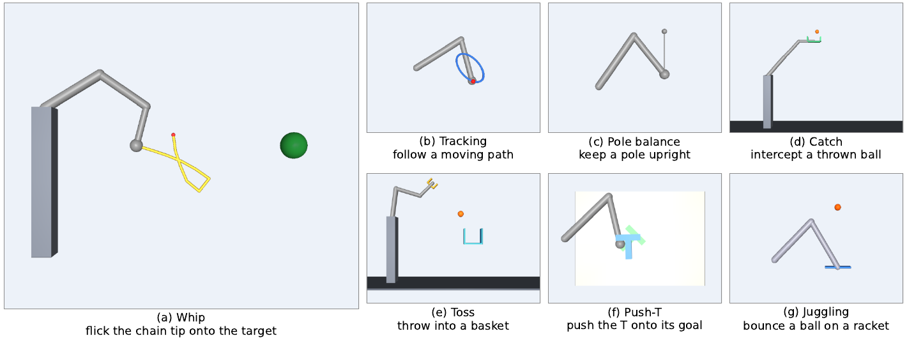

*The seven tasks: (a) whip, the main test bed, (b) tracking, (c) pole balance, (d) catch, (e) toss, (f) Push-T, (g) juggling. Each panel is a MuJoCo render under nominal parameters from a classical teacher's rollout on a calibration seed.*

## Main results

- In 8 tracking, juggling and whip settings, no learned method cleared the pre-specified +10 pp bar over the strongest classical baseline. Only whip was measured to leave room (headroom) above the classical pipeline.
- In 3 of the 8 settings the residual reinforcement-learning (RL) learner did not learn. In two of them (juggling and idealised whip), with a gate-passing exploration scale, it degraded its base (its classical start) by 17.6 to 23.8 pp (juggling -23.8 pp [-26.9, -20.7], idealised whip -17.6 pp [-20.3, -14.9], both on HOLD, n = 500).
- Our own first experiment shows how a comparison can mislead: a residual PPO policy beat the untuned computed-torque controller by 16.7% in tracking RMSE, but after a two-parameter retune of the teacher it was 7.1% worse (95% CI [-13.8, +0.3]%).
- On realistic whip, the once-only locked set TEST-C (n = 500) shows that the true physical parameters add +17.6 pp [12.6, 22.6] over fitted ones. This is the largest single rung of the headroom ladder.
- Robust plan selection scores candidate swings under several plausible parameter sets. It was built for the learned side and then given to the classical side. On a second locked set, TEST-D (gap +18.0 pp), it alone recovers 0.59 [0.36, 0.82] of the gap with a classical ensemble, and 0.90 [0.68, 1.16] with learned estimators trained on simulator labels and true-plant oracle plans.
- The learned side keeps a lead of +5.6 pp [0.6, 10.6] over the upgraded classical side, and an advantage of 10 pp cannot be excluded.
- Caveats: one simulator and mostly one task. The classical comparator on whip (C-ens) was built after the learned result was seen. The sanity gate passed only marginally (+10.2 pp against a +10 pp threshold). The multimodal-teacher result (replacing a multimodal whip teacher by a canonical one raised every student's success by 17.5 to 33.5 pp) has no locked-set confirmation.

The full method, the statistics and the limitations are in the paper.

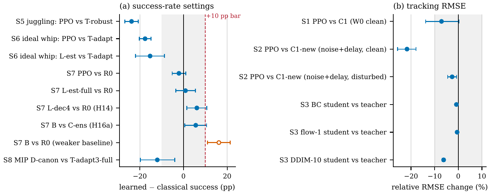

*Learned minus strongest classical, per setting. Left: success-rate settings, grey band +-10 pp, dashed line at the +10 pp bar. Right: tracking settings in relative RMSE change (positive = learned better). Bars are 95% bootstrap CIs. The single hollow point clears the bar, but only against the weaker baseline R0 (the fitted-parameter classical pipeline on whip). Evidence sets differ across rows.*

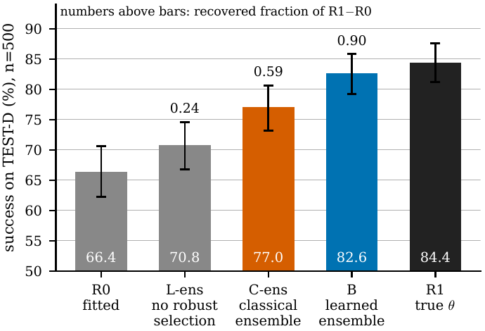

*Robust plan selection recovers about 60% of the parameter gap on the locked set TEST-D: 0.59 of the R1-R0 gap with the classical ensemble C-ens and 0.90 with the learned ensemble B. Bars: success with 95% CI; numbers above the bars: recovered fraction of the gap. R0 uses fitted parameters and R1 the true parameters. The y axis starts at 50%.*

## Videos

Each clip is a render from the benchmark, played inline as a small GIF (click one for the MP4). The clips were rendered on calibration seeds (not test seeds). Where a second clip is shown, it is a calibration seed on which the classical teacher fails once a single model error is injected. Per-task goals, teachers and the role each task plays in the study are on the [project site](https://jadiouo.github.io/controller-ladder/#task-whip).

**Whip: the main test bed.** The arm flings a chain of ten capsules so that the tip passes within 0.08 m of a target outside its 1.0 m reach. The chain state is not observed.

| Nominal | With model error: chain 10% shorter |
|---|---|
| [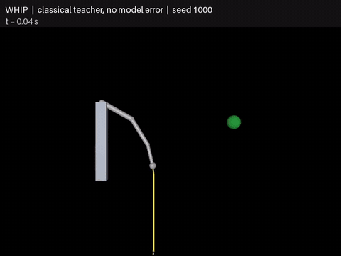](web/media/whip_success.mp4) | [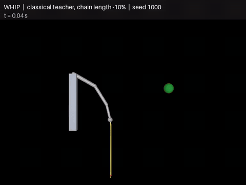](web/media/whip_failure.mp4) |

**Other tasks.**

| Task and condition | Clip |
|---|---|
| Tracking: classical teacher, nominal plant | [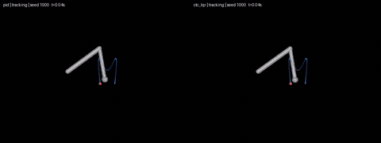](web/media/tracking.mp4) |
| Pole balancing: classical controller (classical ladder only) | [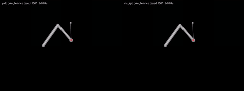](web/media/pole_balance.mp4) |
| Racket juggling: classical teacher | [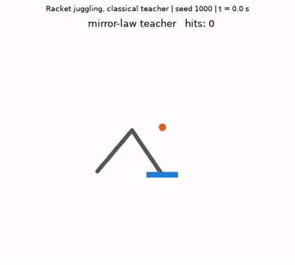](web/media/juggling.mp4) |
| Catching a thrown ball: nominal | [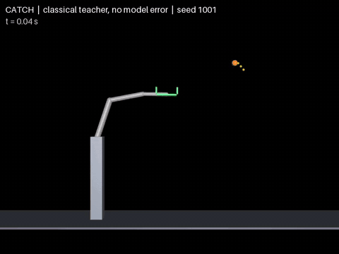](web/media/catch_success.mp4) |
| Catching: with model error, 10 ms ball-observation delay | [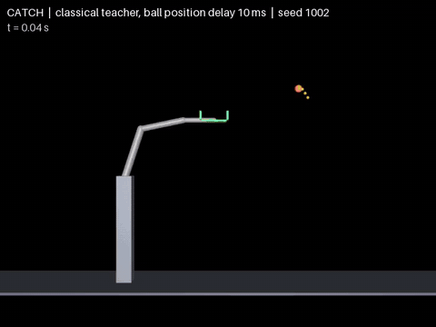](web/media/catch_failure.mp4) |
| Toss into a basket: nominal | [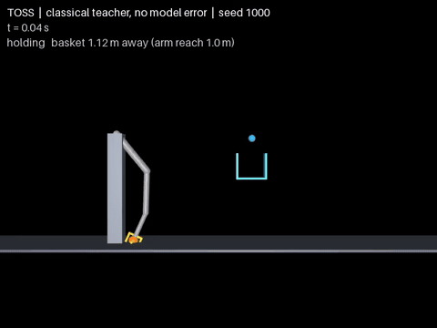](web/media/toss_success.mp4) |
| Toss: with model error, release 40 ms late | [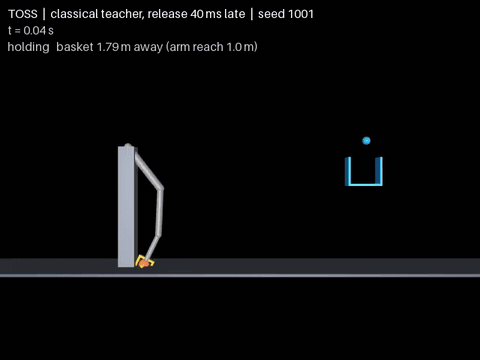](web/media/toss_failure.mp4) |
| Push-T: nominal | [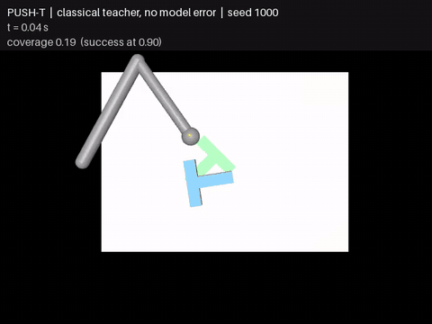](web/media/push_t_success.mp4) |
| Push-T: with model error, 30 ms sensor delay | [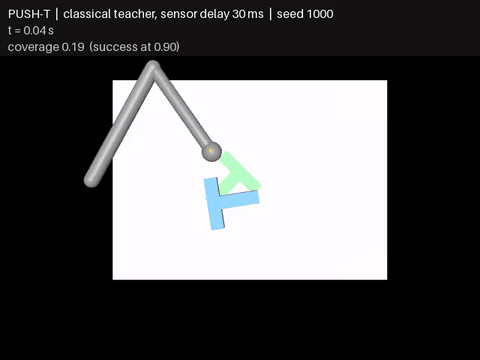](web/media/push_t_failure.mp4) |

## Quick start

Python >= 3.10 (`pyproject.toml`). Dependencies: numpy, scipy, mujoco, pillow (an ffmpeg binary is optional, for mp4). MuJoCo is not pinned in `pyproject.toml`; the Python reference used to validate the browser arena was the `mujoco` 3.17.0 wheel (the browser arena uses the npm package mujoco@3.1.16, whose WASM build reports MuJoCo 3.5.1).

```bash
python -m venv .venv && . .venv/bin/activate
pip install -e . pytest
python -m pytest -q                              # all tests, serial
python -m pytest -q tests/test_spike_repro.py    # numerical reproduction of spike01/02 (needs experiments/spike/ and experiments/spike02/ unchanged)
python scripts/demo_ladder.py                    # about a minute; writes tables and mp4 to results/arena_demo/
python -m http.server -d web                     # serve the portfolio site and the browser arena locally
```

Unit tests never write `results/.test_access.log`; real evaluations on the locked seed sets do (see `docs/provenance.md`). Video backend: `MUJOCO_GL=egl` (set automatically by `arena.viz`). Some experiments (`spike*/`, `arena/learn`, `arena_mjx`, `scripts/mjx_*`) additionally need torch and/or JAX/MJX (and a GPU for the larger runs); they are not needed for the tests.

### Reproduce the paper tables

- Every experiment is one directory `experiments/spikeNN/` (code; index in `experiments/README.md`) with outputs in `results/spikeNN/` (`README.md` with the pre-specification and deviations, `table.md`, JSON summaries, per-episode `.npy` arrays where small).
- `docs/experiments.tsv` lists, per run, the hypothesis ids, seeds, command and result file. `docs/canonical_numbers.md` maps every number used in the paper to a run and command. `paper/support/claims_evidence.md` (section 5) gives the "regenerate table" command per result.
- Cheap path (no simulation): these scripts rebuild their tables from the data included here, and the output matches the committed `table.md` exactly (checked on a fresh clone): `python experiments/spike15a/stats15.py` (TEST-C ladder), `python experiments/spike15b/report15.py`, `python experiments/spike13b/report13.py`, `python experiments/spike11a/report11.py`, `python experiments/spike12a/report12.py`, `python experiments/spike16a/report16.py`. The other table scripts (for example `spike15e/stats15e.py testd`, `spike10b/report10b.py`, `spike13a/report13.py`, `paper/support/stats/equivalence.py`) need per-episode arrays that are not in this release because of their size; they stop with a missing-file error and leave the committed tables unchanged.
- Full re-runs are listed in each `results/spikeNN/README.md` ("Re-run"). Some are long (hours; RL training), and a few use locked test seeds that must be evaluated **once**: do not repeat TEST-B, TEST-C or TEST-D runs.
- The frozen whip estimator weights used on TEST-D are included (`results/spike15c/models/`, 15 MB). Other weights, training-data shards and large arrays are not included (size); see `RELEASE_NOTES.md` for the list. Tables derived from them are included.

### Evaluation protocol in one paragraph

Seeds are split into disjoint sets: CAL (tuning), HOLD / NEW (model selection and fresh checks) and TEST sets: 0-49 (older experiments, reused) and the locked sets TEST-B 20000-20499, TEST-C 30000-30499 and TEST-D 40000-40499, each evaluated once for its pre-specified hypothesis card. Hypothesis cards (`docs/03_hypotheses.md`) were frozen before the corresponding confirmatory runs; the commit-order evidence is in `docs/provenance.md`. Confidence intervals are paired; margins are stated in the cards.

## Repository layout

| Path | Contents |
|---|---|
| `arena/` | Robots, tasks, perturbations, controllers, evaluation, viz, learning (BC/MIP/diffusion/flow) |
| `arena_mjx/` | JAX/MJX vectorised environment and PPO (GPU) |
| `experiments/` | Experiment code, one `spikeNN/` folder per study (index: `experiments/README.md`; commands: `docs/experiments.tsv`) |
| `scripts/` | Demos and MJX benchmarks |
| `tests/` | Unit tests and numerical-reproduction tests |
| `web/` | Portfolio site, task videos (`web/media/`) and the in-browser MuJoCo arena (`web/arena/`, validated against Python in `web/arena/VALIDATION.md`) |
| `docs/` | Hypotheses, rulers, experiments table, canonical numbers, provenance, `ARCHITECTURE.md` |
| `paper/` | `arxiv/`: LaTeX source, figures (and the figure script), compiled `main.pdf`; `support/`: claims-evidence map, pre-specification audit, equivalence statistics |
| `docs/media/` | GIFs used in this README (converted from `web/media/*.mp4`) |
| `results/` | Small result files (tables, JSON, logs) |

Architecture, how to add a task / controller / perturbation, and the design decisions: `docs/ARCHITECTURE.md`.

## About the pre-registration

The pre-specification is the series of hypothesis cards in `docs/03_hypotheses.md` (final version v9; the cards are written in Chinese). The evidence that each card was frozen before its confirmatory result is the commit order of the author's private development repository. This public repository is a clean export that does not contain the private development history, so `docs/provenance.md` lists, per card version and per spike, the abbreviated commit hash, author date and subject. Each result is marked in the paper as PRE-git (rule committed before the result in git), PRE-README (rule only in the experiment's README) or POST (post hoc).

Limits, stated plainly: there is no third-party timestamp, and the author dates are from the committer's local clock and are not notarised. The hashes belong to the private repository, so until the author provides it (or a signed `git log` / bundle) on request, the provenance tables are an assertion by the author, not an independently verifiable proof. Git order shows the rule committed before the result for 11 spikes, among them the two locked-set runs on TEST-C and TEST-D, but not for all; for ten spikes it cannot be shown because the rule and the result share a commit or the rule lived in a task prompt. No case was found in which git shows a rule committed after its result. The locked-seed access log is `results/.test_access.log`.

## Use of AI tools

The research question, the choice of tasks, every direction change and every decision recorded in the hypothesis cards were made by the author. Most of the code, the execution of the experiments, the statistical analysis and the drafting of the paper were carried out by AI agents (Anthropic's Claude models, used through Claude Code) working under the author's direction; internal reviews of the drafts were also simulated with AI agents. The author checked the results and takes full responsibility for the content.

## Citation

```bibtex
@misc{ho2026controllerladder,
  title  = {An Audited, Budget-Disclosed Benchmark of Classical Teachers and
            Learned Students on a Simulated Arm},
  author = {Ho, Hao-Ting},
  year   = {2026},
  note   = {arXiv preprint, link to be added},
  url    = {https://github.com/Jadiouo/controller-ladder}
}
```

Citation metadata: [`CITATION.cff`](CITATION.cff).

## License

MIT, see [`LICENSE`](LICENSE).
