# An Audited, Budget-Disclosed Benchmark of Classical Teachers and Learned Students on a Simulated Arm

（中文：在模擬機械臂上，一個有稽核、公開預算的古典老師對學習式學生基準）

**在 8 個追蹤、雜耍與甩鞭設定中，沒有任何學習式方法在對上最強古典基準時，達到事前訂下的 +10 個百分點門檻。**

[English](README.md) | [論文（PDF，英文）](docs/paper/arxiv/main.pdf) | **[互動網站](https://jadiouo.github.io/controller-ladder/)** | **[在瀏覽器裡玩擂台](https://jadiouo.github.io/controller-ladder/arena/)**

學習式與古典控制的比較，常常沒有給古典這一方同等的調參、沒有公開預算，也沒有在測試前固定規則。這個 repo 是論文背後的 MuJoCo 基準與評估協定。機器人、任務、擾動（「弱點」）、控制器（PID、computed-torque + LQR、iLQR、iLQR-MPC、MPPI、residual RL，以及 BC、MIP、diffusion、flow matching 等模仿學生）和評估協定都接在同一個介面上，所以每一次比較都用同樣方式記錄和製表。協定包含：調好參數的古典基準、三個面向（回合數、實際時間、標籤來源）的預算公開、測試前就有時間戳的規則、一道健全性檢查（學習者要先能學會一個已知學得會的修正），以及測試評估紀錄。核心問題是：*學習式控制器還需要什麼額外的東西，才能贏過它的古典老師？*

七個任務都能在瀏覽器裡玩：七個都跑在 MuJoCo WASM 擂台上，而且每一個都對照 Python 實作驗證過（見 [`web/arena/VALIDATION.md`](web/arena/VALIDATION.md)）。

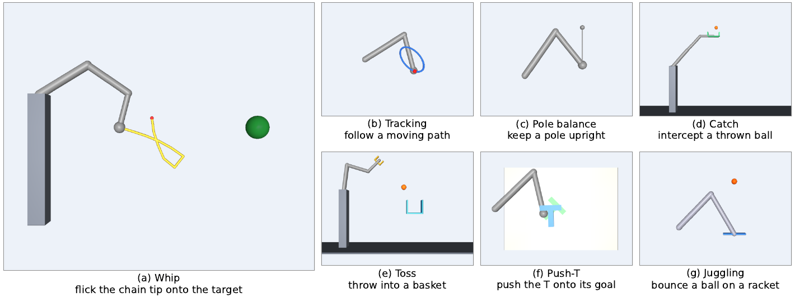

*七個任務：(a) 甩鞭（主要測試場景）、(b) 追蹤、(c) 平衡桿、(d) 接球、(e) 投籃、(f) Push-T、(g) 雜耍。每個畫面都是標稱參數下的 MuJoCo 渲染，取自古典老師在校準種子上的一次執行。*

## 主要結果

- 在 8 個追蹤、雜耍與甩鞭設定中，沒有任何學習式方法在對上最強古典基準時，達到事前訂下的 +10 pp 門檻。只有甩鞭被量到古典流程之上還有空間（headroom）。
- 8 個設定中有 3 個，residual 強化學習（RL）學習者沒有學起來。其中兩個（雜耍與理想化甩鞭），在通過健全性檢查的探索尺度下，它反而讓自己的基底（它的古典起點）退步 17.6 到 23.8 pp（雜耍 -23.8 pp [-26.9, -20.7]、理想化甩鞭 -17.6 pp [-20.3, -14.9]，皆為 HOLD，n = 500）。
- 我們自己的第一個實驗就示範了比較怎麼會誤導：residual PPO 在追蹤 RMSE 上比未調參的 computed-torque 控制器好 16.7%，但老師做完兩個參數的重調之後，它反而差 7.1%（95% CI [-13.8, +0.3]%）。
- 在真實條件的甩鞭上，只能評估一次的鎖定測試集 TEST-C（n = 500）顯示，真實物理參數比擬合參數多出 +17.6 pp [12.6, 22.6]。這是 headroom 階梯裡最大的單一階。
- 穩健計畫選擇（robust plan selection）會在數組合理的參數下替候選揮鞭打分。它原本是為學習這一方做的，後來也給了古典這一方。在第二個鎖定測試集 TEST-D（差距 +18.0 pp）上，光是它，搭配古典 ensemble 就補回差距的 0.59 [0.36, 0.82]；搭配以模擬器標籤與真實植體的 oracle 計畫訓練出來的學習式估計器，則補回 0.90 [0.68, 1.16]。
- 學習這一方對升級後的古典這一方仍領先 +5.6 pp [0.6, 10.6]，而且 10 pp 的優勢無法排除。
- 限定：只有一個模擬器、主要只有一個任務。甩鞭上的古典對照組（C-ens）是在看到學習式結果之後才做的。健全性檢查只是勉強通過（+10.2 pp，門檻 +10 pp）。多峰老師的結果（把多峰甩鞭老師換成典型老師，所有學生的成功率提高 17.5 到 33.5 pp）沒有鎖定測試集的確認。

完整方法、統計與限制都在論文裡。

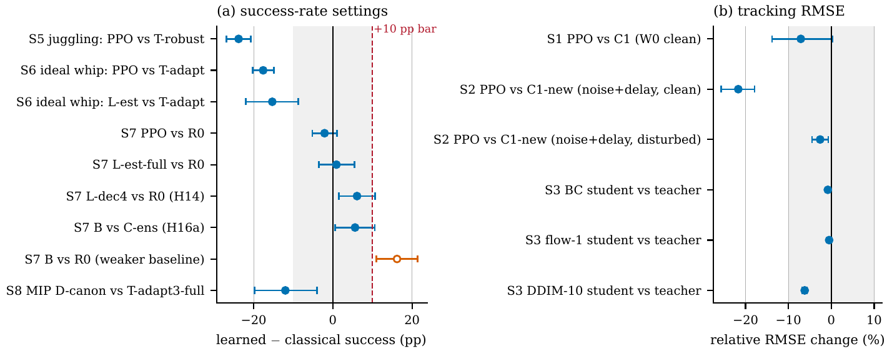

*各設定的學習式減最強古典。左：成功率設定，灰色帶為 +-10 pp，虛線為 +10 pp 門檻。右：追蹤設定，以相對 RMSE 變化表示（正值代表學習式較好）。誤差條是 95% bootstrap CI。唯一的空心點有過門檻，但只是對上較弱的基準 R0（甩鞭上用擬合參數的古典流程）。各列使用的證據集不同。*

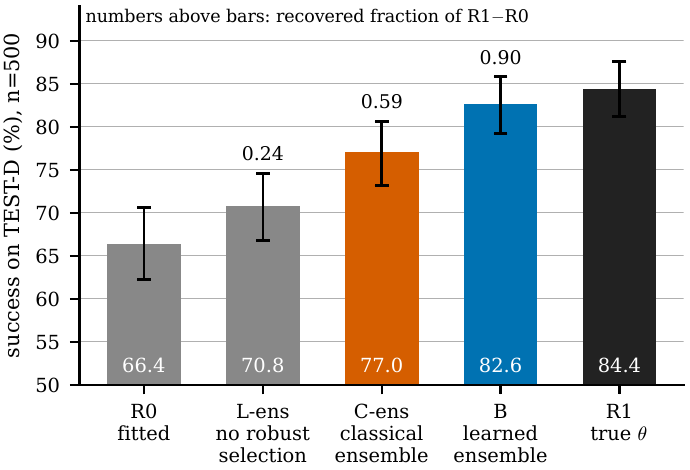

*穩健計畫選擇在鎖定測試集 TEST-D 上補回約 60% 的參數差距：古典 ensemble C-ens 補回 R1-R0 差距的 0.59，學習式 ensemble B 補回 0.90。長條：成功率與 95% CI；長條上方的數字：補回的差距比例。R0 用擬合參數，R1 用真實參數。y 軸從 50% 開始。*

## 影片

每支影片都是基準的渲染，以小 GIF 內嵌（點一下看 MP4）。影片是在校準種子（不是測試種子）上渲染的。有第二支影片的任務，它是在某個校準種子上，古典老師一旦被注入單一模型誤差就會失敗的例子。每個任務的目標、老師與它在研究中的角色，見[專案網站](https://jadiouo.github.io/controller-ladder/#task-whip)。

**甩鞭：主要測試場景。** 手臂甩動一條由十節膠囊組成的鏈，讓鏈尖通過離目標 0.08 m 以內，而目標在手臂 1.0 m 的觸及範圍之外。鏈的狀態觀測不到。

| 標稱 | 有模型誤差：鏈短 10% |
|---|---|
| [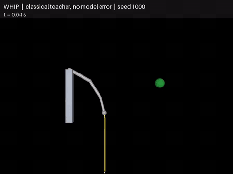](web/media/whip_success.mp4) | [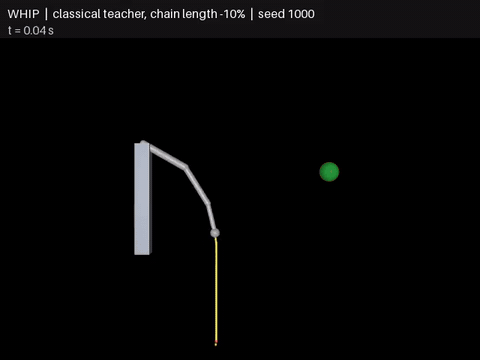](web/media/whip_failure.mp4) |

**其他任務。**

| 任務與條件 | 影片 |
|---|---|
| 追蹤：古典老師，標稱植體 | [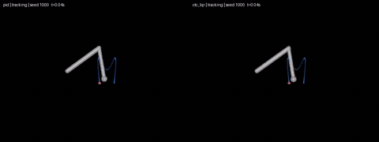](web/media/tracking.mp4) |
| 平衡桿：古典控制器（只跑古典階梯） | [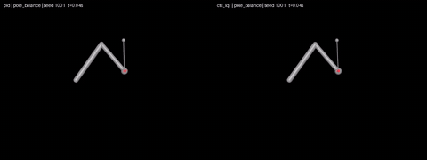](web/media/pole_balance.mp4) |
| 球拍雜耍：古典老師 | [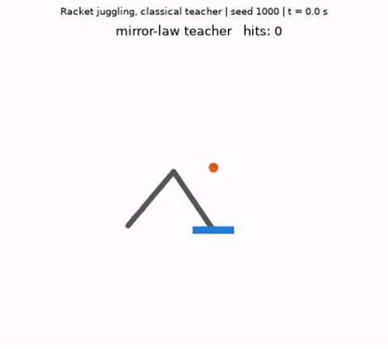](web/media/juggling.mp4) |
| 接球：標稱 | [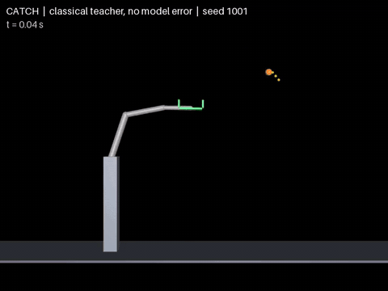](web/media/catch_success.mp4) |
| 接球：有模型誤差，球的觀測延遲 10 ms | [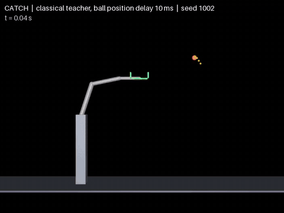](web/media/catch_failure.mp4) |
| 投進籃子：標稱 | [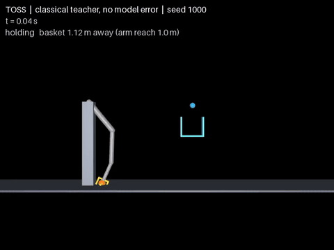](web/media/toss_success.mp4) |
| 投籃：有模型誤差，釋放時間晚 40 ms | [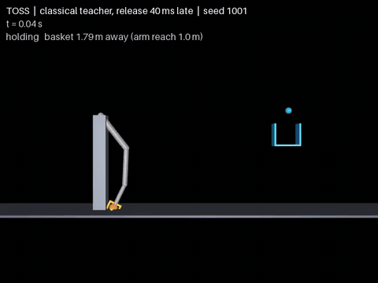](web/media/toss_failure.mp4) |
| Push-T：標稱 | [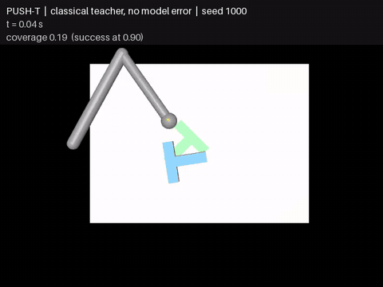](web/media/push_t_success.mp4) |
| Push-T：有模型誤差，感測器延遲 30 ms | [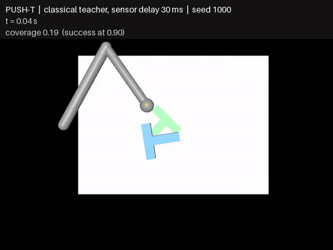](web/media/push_t_failure.mp4) |

## 快速開始

Python >= 3.10（`pyproject.toml`）。相依套件：numpy、scipy、mujoco、pillow（ffmpeg 執行檔可選，用來輸出 mp4）。`pyproject.toml` 沒有鎖定 MuJoCo 版本；用來驗證瀏覽器擂台的 Python 參考是 `mujoco` 3.17.0 wheel（瀏覽器擂台用 npm 套件 mujoco@3.1.16，其 WASM 回報版本為 MuJoCo 3.5.1）。

```bash
python -m venv .venv && . .venv/bin/activate
pip install -e . pytest
python -m pytest -q                              # 全部測試，序列執行
python -m pytest -q tests/test_spike_repro.py    # spike01/02 的數值重現（spike/ 與 spike02/ 必須沒被改過）
python scripts/demo_ladder.py                    # 約一分鐘；把表格與 mp4 寫到 results/arena_demo/
python -m http.server -d web                     # 在本機架起作品集網站與瀏覽器擂台
```

單元測試不會寫入 `results/.test_access.log`；在鎖定種子集上的真實評估才會（見 `docs/provenance.md`）。影片後端：`MUJOCO_GL=egl`（由 `arena.viz` 自動設定）。部分實驗（`spike*/`、`arena/learn`、`arena_mjx`、`scripts/mjx_*`）另外需要 torch 和／或 JAX/MJX（較大的執行還需要 GPU）；跑測試不需要它們。

### 重現論文的表格

- 每個實驗是一個 `spikeNN/` 資料夾（程式），輸出在 `results/spikeNN/`（含預先規格與偏離說明的 `README.md`、`table.md`、JSON 摘要，以及體積小的逐回合 `.npy`）。
- `docs/experiments.tsv` 逐次列出假設編號、種子、指令與結果檔。`docs/canonical_numbers.md` 把論文用到的每個數字對應到一次執行與指令。`docs/paper/claims_evidence.md`（第 5 節）給出每個結果的「重新產生表格」指令。
- 便宜的路徑（不用模擬）：從存下來的逐回合資料重建表格，例如 `python spike15e/stats15e.py testd`、`python spike10b/report10b.py`、`python spike13a/report13.py`、`python spike15b/report15.py`、`python docs/paper/stats/equivalence.py`。
- 完整重跑列在各 `results/spikeNN/README.md`（「Re-run」）。有些很久（好幾個小時；RL 訓練），少數用到鎖定測試種子，這些只能評估**一次**：不要重跑 TEST-B、TEST-C、TEST-D。
- TEST-D 用到的凍結甩鞭估計器權重已附上（`results/spike15c/models/`，15 MB）。其他權重、訓練資料分片與大型陣列因為體積沒有附上，清單見 `RELEASE_NOTES.md`。由它們導出的表格有附上。

### 一段話說明評估協定

種子分成互不重疊的集合：CAL（調參）、HOLD / NEW（模型選擇與新鮮種子檢查）和 TEST 集：0-49（較早的實驗，重複使用過），以及鎖定集 TEST-B 20000-20499、TEST-C 30000-30499、TEST-D 40000-40499，各自只為事前訂好的假設卡評估一次。假設卡（`docs/03_hypotheses.md`）在對應的驗證性實驗之前就已凍結；commit 順序的證據在 `docs/provenance.md`。信賴區間是配對的；容許範圍寫在假設卡裡。

## Repo 結構

| 路徑 | 內容 |
|---|---|
| `arena/` | 機器人、任務、擾動、控制器、評估、視覺化、學習（BC/MIP/diffusion/flow） |
| `arena_mjx/` | JAX/MJX 向量化環境與 PPO（GPU） |
| `spike*/` | 實驗程式，一個研究一個資料夾（見 `docs/experiments.tsv`） |
| `scripts/` | 展示與 MJX 效能測試 |
| `tests/` | 單元測試與數值重現測試 |
| `web/` | 作品集網站、任務影片（`web/media/`）與瀏覽器內的 MuJoCo 擂台（`web/arena/`，對 Python 的驗證見 `web/arena/VALIDATION.md`） |
| `docs/` | 假設、評估尺、實驗表、canonical numbers、provenance、論文輔助檔、`ARCHITECTURE.md` |
| `docs/paper/arxiv/` | LaTeX 原始檔、圖（與繪圖腳本）、編譯好的 `main.pdf` |
| `docs/media/` | 這份 README 用的 GIF（由 `web/media/*.mp4` 轉出） |
| `results/` | 體積小的結果檔（表格、JSON、log） |

架構、怎麼新增任務／控制器／擾動，以及設計決定：`docs/ARCHITECTURE.md`。

## 關於預先登記

預先規格就是 `docs/03_hypotheses.md` 裡的一系列假設卡（最終版 v9；假設卡是用中文寫的）。每張卡在它的驗證性結果之前就已凍結，證據是作者私人開發 repo 的 commit 順序。這個公開 repo 是乾淨的匯出版本，不含私人開發歷史，所以 `docs/provenance.md` 依卡片版本與 spike 逐項列出縮短的 commit hash、作者日期與主旨。論文中每個結果都標為 PRE-git（規則在 git 裡先於結果 commit）、PRE-README（規則只在該實驗的 README 裡）或 POST（事後分析）。

限制照實寫：沒有第三方時間戳，作者日期來自 committer 本機時鐘，沒有經過公證。這些 hash 屬於私人 repo，所以在作者依要求提供私人 repo（或簽署的 `git log`／bundle）之前，provenance 表格是作者的陳述，不是可獨立驗證的證明。git 順序顯示規則先於結果的有 11 個 spike，包括 TEST-C 與 TEST-D 這兩次鎖定集執行，但不是全部；有十個 spike 無法證明，因為規則與結果在同一個 commit，或規則只存在於任務提示裡。沒有發現任何一個案例，git 顯示規則是在結果之後才 commit。鎖定種子的存取紀錄是 `results/.test_access.log`。

## AI 工具使用揭露

研究問題、任務的選擇、每一次方向改變，以及假設卡裡記錄的每一個決定，都由作者做出。大部分的程式碼、實驗的執行、統計分析與論文初稿的撰寫，是由 AI 代理（Anthropic 的 Claude 模型，透過 Claude Code 使用）在作者指揮下完成；草稿的內部審查也是用 AI 代理模擬的。作者檢查了結果，並對內容負全責。

## 引用

```bibtex
@misc{ho2026controllerladder,
  title  = {An Audited, Budget-Disclosed Benchmark of Classical Teachers and
            Learned Students on a Simulated Arm},
  author = {Ho, Hao-Ting},
  year   = {2026},
  note   = {arXiv preprint, link to be added},
  url    = {https://github.com/Jadiouo/controller-ladder}
}
```

引用中繼資料：[`CITATION.cff`](CITATION.cff)。

## 授權

MIT，見 [`LICENSE`](LICENSE)。
